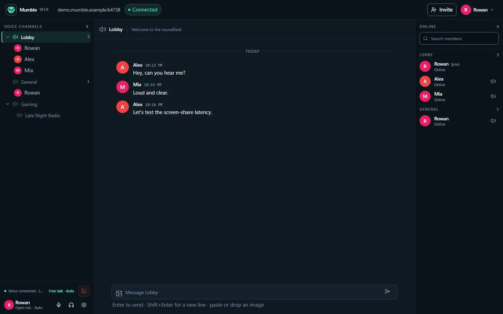
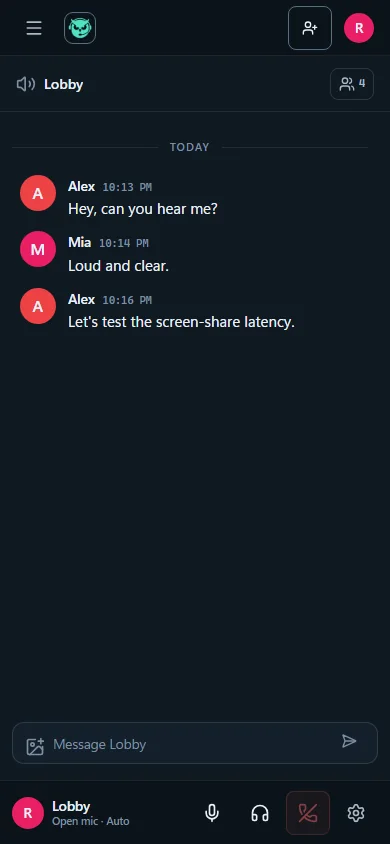

<p align="center">
  <a href="README.md">English</a> · <a href="README.zh-CN.md">简体中文</a>
</p>

<p align="center">
  
</p>

<h1 align="center">Mumble Web</h1>

<p align="center">
  Bring your Mumble voice server into the browser: no client install, just open a link.
</p>

<p align="center">
  <a href="https://mumble.info"></a>
  <a href="https://react.dev"></a>
  <a href="https://go.dev"></a>
  <a href="LICENSE"></a>
</p>

Mumble Web is a web client for Mumble servers. It combines a **React frontend** with a **Go proxy**:
the browser handles the UI and WebRTC audio, while the proxy speaks the Mumble protocol, manages
sessions, and forwards voice frames to any Murmur server.

Built for:

- Teams that don't want to install the Mumble client but need to hop into voice;
- Pulling external guests into a channel with a single invite link;
- Managing channels, chat, members, and basic settings from the browser.

<p align="center">
  
</p>
<p align="center">
  
</p>

---

## Table of contents

- [Features](#features)
- [Architecture](#architecture)
- [Quick start](#quick-start)
- [Configuration](#configuration)
- [Duplicate nicknames](#duplicate-nicknames)
- [Invite links](#invite-links)
- [Development and testing](#development-and-testing)
- [Project structure](#project-structure)
- [Known limitations](#known-limitations)
- [Roadmap](#roadmap)
- [License and third-party notices](#license-and-third-party-notices)
- [Contributing and security](#contributing-and-security)

## Features

| Area | What you get |
|---|---|
| **Voice** | WebRTC + Opus; push-to-talk / voice activity; automatic noise gate with manual threshold; hot-swap input/output devices; per-user volume and local mute; mic/headphone mute |
| **Chat** | Per-channel text chat; paste/select/drag images; link detection; message grouping and date dividers; unread indicators |
| **Channels and members** | Real collapsible channel tree; click to view, double-click/hover to join; talking users, speaking indicator, mute/deafen/priority-speaker states; member search and grouping by channel |
| **UI** | Three-column workspace; desktop voice card; mobile bottom voice dock with channel/member drawers; six settings tabs (Audio, Voice, Shortcuts, Appearance, Diagnostics, About) |
| **Experience** | Instant Chinese/English switching; image viewer (multi-image, zoom, pan, mobile gestures); toasts; localized error codes; `prefers-reduced-motion` |
| **Operations** | One proxy serves static pages and WebSocket; Docker Compose; SRV resolution; TLS `verify` / `pin` / `insecure`; one-click web invites + bot API; diagnostics export |

## Architecture

```text
┌──────────────────────────────┐
│ Browser                      │
│ React 19 + WebRTC (Opus)     │
└──────────────┬───────────────┘
               │ WebSocket JSON + RTP
┌──────────────▼───────────────┐
│ Go proxy                     │
│ Control bridge: gumble       │
│ Media bridge: Pion, Opus     │
│ frame passthrough            │
└──────────────┬───────────────┘
               │ TCP + TLS + Protobuf
               │ Mumble UDPTunnel
┌──────────────▼───────────────┐
│ Murmur / Mumble server       │
└──────────────────────────────┘
```

- **Control channel**: WebSocket JSON for login, channel tree, user state, text messages, and mute/deafen.
- **Voice channel**: browser WebRTC (native Opus, echo cancellation, jitter buffer) ⇄ proxy. The proxy
  does not decode or re-encode; it forwards Opus payloads between RTP and Mumble voice frames, with one
  RTP track per speaker.
- **Upstream voice**: currently Mumble `UDPTunnel` (TCP tunnel); native UDP + AES-OCB is a future upgrade.

## Quick start

### Docker Compose (recommended)

```bash
git clone https://github.com/9Solitary/Mumble-Web.git mumble-web
cd mumble-web

cp .env.example .env
# Edit .env: MUMBLE_SERVER, MUMBLE_TLS, etc.

docker compose up -d
```

Open `http://localhost:8080`, enter a nickname and the server password.

```bash
docker compose logs -f            # follow logs
docker compose ps                 # container status
docker compose down               # stop
docker compose up -d --build      # rebuild after code changes
```

Plain Docker (without Compose):

```bash
docker build -t mumble-web-proxy .
docker build -t mumble-web -f Dockerfile.web .

docker run -p 8081:8081 -p 50000:50000/udp mumble-web-proxy
docker run -p 8080:80 -e PROXY_ORIGIN=http://<proxy-host>:8081 mumble-web
```

> Read [DEPLOYMENT.md](DEPLOYMENT.md) before deploying to production. It covers split web/proxy
> deployments, HTTPS, UDP ports, and migration.

### Local development

```bash
# Frontend
npm install
npm run build          # writes dist/
npm run dev            # http://localhost:3000

# Proxy (separate terminal)
cd server
go run ./cmd/proxy -static ../dist
```

The Vite dev server proxies `/api` and `/ws` to `localhost:8080`.

## Configuration

The proxy is configured with environment variables (or matching CLI flags):

| Variable | Default | Description |
|---|---|---|
| `MUMBLE_SERVER` | `localhost:64738` | Upstream server; SRV lookup is used when no port is given |
| `MUMBLE_TLS` | `verify` | `verify` / `pin:<sha256>` / `insecure` |
| `LISTEN` / `PORT` | `:8080` | HTTP/WebSocket listener |
| `RTC_UDP_PORT` | `50000` | WebRTC ICE UDP port; must be reachable from browsers |
| `RTC_PUBLIC_IP` | empty | Public IP when the proxy is behind NAT |
| `STATIC_DIR` | `dist` | Frontend static asset directory |
| `ALLOW_SERVER_OVERRIDE` | `true` | Allow users to choose an upstream server on the connect screen |
| `WEB_INVITE_ENABLED` | `true` | Allow signed-in users to create invites in the web UI |
| `INVITE_SECRET` | empty | Bearer secret for the bot invite API; empty disables bot-created invites |
| `INVITE_TTL` | `30m` | Invite link lifetime |
| `FRONTEND_URL` | empty | Frontend base URL for invite links; inferred from WS Origin / request Host when empty |

The web container also accepts `PROXY_ORIGIN`, `PROXY_UPSTREAM`, and `WEB_PORT`; see
[.env.example](.env.example) and [DEPLOYMENT.md](DEPLOYMENT.md).

## Duplicate nicknames

Mumble nicknames are a single identity. This project makes **web-client-to-web-client** behavior
deterministic:

- Two tabs/clients with the same name: **the later web login is rejected** with "this nickname is
  already in use"; the existing session stays online.
- Refreshing or reconnecting in the same tab restores the original session via the page's `clientId`
  (`sessionStorage`), so it is not mistaken for a duplicate.

However, **conflicts involving native Mumble clients are still decided by Murmur**: by default, a new
login kicks the old session. If a native client is online first and a web client logs in with the same
name, the native client will still be kicked; the proxy cannot see native users before login, nor
prevent a native client from logging in later. The maintainer keeps full feasibility notes locally;
they are not published with the repository.

## Invite links

Signed-in users can click **Invite** in the top bar to create a one-time link:

- Valid for `INVITE_TTL`; claimed by the first successful login; invalidated immediately on logout or
  disconnect.
- Invitees only see a nickname field; the server and password are stored server-side and never appear
  in the URL.
- Invitees (including reconnecting invited sessions) cannot invite anyone else.
- Invites are in-memory only; restarting the proxy clears them.
- Set `WEB_INVITE_ENABLED=false` to hide the web entry point; existing invite validation, invited
  login, and reconnect are unaffected.

Bots can still call `POST /api/invites`, but only when `INVITE_SECRET` is configured:

```bash
curl -X POST https://<host>:8080/api/invites \
  -H "Authorization: Bearer $INVITE_SECRET" \
  -H "Content-Type: application/json" \
  -d '{"serverAddr":"optional, defaults to the proxy upstream","password":"optional, server password"}'
# => {"token":"...","url":"https://<host>:8080/invite/<token>","expiresAt":1729000000}
```

- Keep `INVITE_SECRET` on the proxy and bot backend only; never ship it to end users.
- Bot and web invites share the same in-memory store; the `GET /api/invites/{token}` contract is unchanged.

## Development and testing

```bash
npm run i18n:check       # zh/en key parity
npm run lint             # ESLint (includes i18next copy checks)
npm test                 # Vitest
npx playwright test --workers=4
npm run test:e2e:cross   # Firefox + WebKit smoke
npm run scan:secrets     # tracked-file secret scan
npm run build            # tsc + Vite
```

Go proxy:

```bash
cd server
go test ./...
go build ./cmd/proxy
```

New user-facing copy must go through `t()` and be added to both `src/i18n/locales/zh-CN.json` and
`en-US.json`. Use Conventional Commits; visual and interaction rules live in
[docs/brand/BRAND.md](docs/brand/BRAND.md).

## Project structure

```text
src/                      React frontend
  components/             UI components (shell/channels/chat/members/settings/viewer)
  components/settings/    Six settings tabs
  hooks/                  Unread, shortcuts, edge swipe, voice state
  lib/                    Protocol, MumbleClient, image compression, diagnostics, shortcuts
  i18n/                   i18next init and zh/en resources
  store/                  appStore / shortcutStore / uiStore
  styles/tokens.css       Design tokens
server/                   Go proxy
  cmd/proxy/              Entrypoint, env, diagnostics
  internal/bridge/        Sessions, registry, WebRTC, voice bridge
  internal/gumble/        Mumble protocol stack (vendor + patches)
  internal/invite/        One-time invite store
  internal/mumbleconn/    SRV resolution and TLS policy
e2e/                      Playwright regressions
scripts/                  i18n and secret checks
docs/brand/               Brand guidelines (BRAND.md)
THIRD_PARTY_LICENSES/     Full third-party license texts
```

## Known limitations

- Upstream voice currently uses Mumble `UDPTunnel` (TCP tunnel); latency and loss resilience are below
  native UDP. Native UDP/AES-OCB is on the roadmap.
- Image messages are limited by Murmur's text-message size and are compressed before sending;
  **originals are not retained**.
- Duplicate-name conflicts with native Mumble clients cannot be prevented by the proxy; see
  [Duplicate nicknames](#duplicate-nicknames).
- Chat history is not persisted; it re-syncs from the server after a refresh or reconnect.
- Dark theme only for now.

## Roadmap

- [ ] Native UDP voice (AES-OCB), replacing the TCP tunnel
- [ ] WebTransport voice channel (replacing WebRTC)
- [ ] User avatars (Mumble texture)
- [ ] Persistent chat history
- [ ] Light theme / command palette (optional)

## License and third-party notices

Released under the **MIT License**; see [LICENSE](LICENSE).

- You may use, modify, distribute, and commercialize it, provided copyright and license notices are
  retained.
- No warranty is provided.
- Third-party components such as gumble (MPL-2.0) and the Mumble protocol definitions (BSD-3-Clause)
  keep their original licenses; see [THIRD_PARTY_NOTICES.md](THIRD_PARTY_NOTICES.md) and
  [THIRD_PARTY_LICENSES/](THIRD_PARTY_LICENSES/).

> "Mumble" is a trademark of the Mumble project. Mumble Web is an independent third-party web client,
> not affiliated with or endorsed by the Mumble project; it does not use the official Mumble icon.

Container images include the same notices and full third-party license texts (web image `/licenses`,
proxy image `/app/licenses`).

## Contributing and security

- Issues and PRs are welcome; run the checks above before submitting.
- Please do not expose server addresses, passwords, TLS pins, or invite tokens in issues, screenshots,
  or logs.
- Report security issues privately via
  [GitHub Security Advisories](https://github.com/9Solitary/Mumble-Web/security/advisories/new).
  Do not post exploit details publicly.
