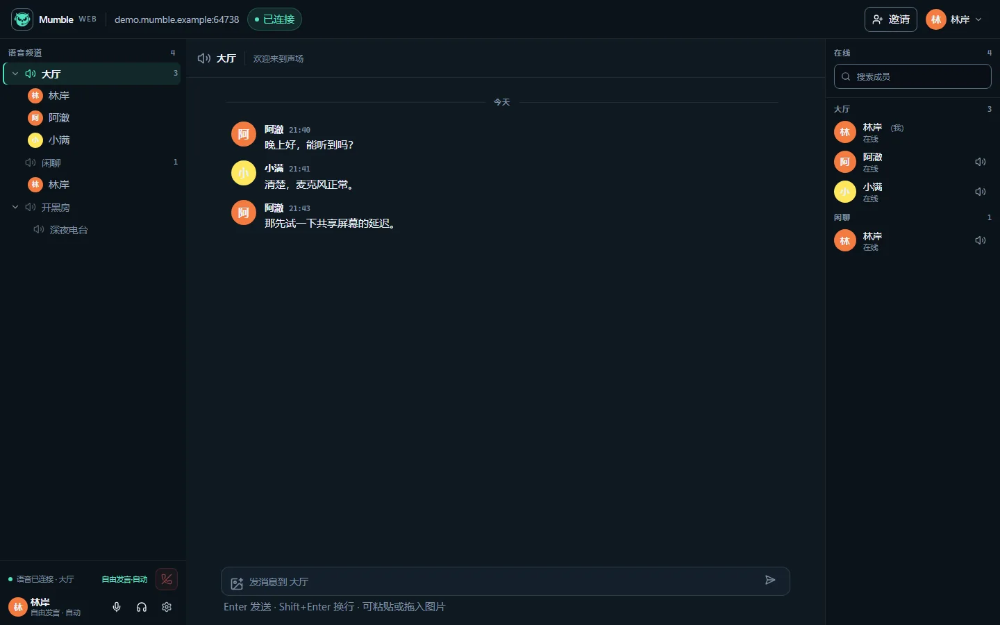
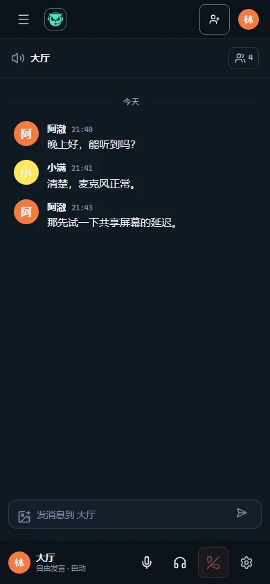

<p align="center">
  <a href="README.md">English</a> · 简体中文
</p>

<p align="center">
  
</p>

<h1 align="center">Mumble Web</h1>

<p align="center">
  把 Mumble 语音服务器搬进浏览器：无需安装客户端，打开链接就能加入。
</p>

<p align="center">
  <a href="https://mumble.info"></a>
  <a href="https://react.dev"></a>
  <a href="https://go.dev"></a>
  <a href="LICENSE"></a>
</p>

Mumble Web 是一个面向 Mumble 服务器的 Web 客户端。它由 **React 前端 + Go 代理** 组成：
浏览器负责界面与 WebRTC 语音，代理负责 Mumble 协议、会话与语音帧透传，最终连接任意 Murmur 服务器。

适合这些场景：

- 成员不想安装 Mumble 客户端，但需要临时加入语音；
- 需要通过一条邀请链接把外部成员拉进频道；
- 希望在浏览器里完成频道、聊天、成员管理和基础设置。

<p align="center">
  
</p>
<p align="center">
  
</p>

---

## 目录

- [功能](#功能)
- [架构](#架构)
- [快速开始](#快速开始)
- [配置](#配置)
- [同名昵称](#同名昵称)
- [邀请链接](#邀请链接)
- [开发与测试](#开发与测试)
- [项目结构](#项目结构)
- [已知限制](#已知限制)
- [路线图](#路线图)
- [许可证与第三方组件](#许可证与第三方组件)

## 功能

| 模块 | 能力 |
|---|---|
| **语音** | WebRTC + Opus；按键说话 / 自由发言；自动噪声门与手动触发阈值；输入/输出设备热切换；单人音量与本地屏蔽；麦克风/耳机静音 |
| **聊天** | 按频道文字聊天；图片粘贴/选择/拖拽发送；链接识别；消息分组与日期分隔；未读提示 |
| **频道与成员** | 真实折叠的频道树；单击查看、双击/悬浮加入；在麦用户、说话指示、静音/闭麦/优先发言状态；成员搜索与按频道分组 |
| **界面** | 三栏工作区；桌面左侧语音卡；移动端底部语音坞与频道/成员抽屉；设置六页签（音频/语音/快捷键/外观/诊断/关于） |
| **体验** | 中英文即时切换；图片查看器（多图/缩放/平移/移动端手势）；Toast；错误码本地化；`prefers-reduced-motion` |
| **运维** | 单代理同时服务静态页面与 WebSocket；Docker Compose；SRV 解析；TLS `verify` / `pin` / `insecure`；网页一键邀请 + bot API；诊断事件导出 |

## 架构

```text
┌──────────────────────────────┐
│ 浏览器                        │
│ React 19 + WebRTC (Opus)      │
└──────────────┬───────────────┘
               │ WebSocket JSON + RTP
┌──────────────▼───────────────┐
│ Go 代理                       │
│ 控制桥：gumble                │
│ 媒体桥：Pion，Opus 帧透传      │
└──────────────┬───────────────┘
               │ TCP + TLS + Protobuf
               │ Mumble UDPTunnel
┌──────────────▼───────────────┐
│ Murmur / Mumble 服务器        │
└──────────────────────────────┘
```

- **控制通道**：WebSocket JSON，负责登录、频道树、用户状态、文字消息、静音/闭麦。
- **语音通道**：浏览器 WebRTC（原生 Opus、回声消除、抖动缓冲）⇄ 代理；代理不解码、不重编码，
  将 Opus 负载在 RTP 与 Mumble 语音帧之间透传，每个说话人一条 RTP track。
- **上游语音**：当前走 Mumble `UDPTunnel`（TCP 隧道）；原生 UDP + AES-OCB 是后续升级项。

## 快速开始

### Docker Compose（推荐）

```bash
git clone https://github.com/9Solitary/Mumble-Web.git mumble-web
cd mumble-web

cp .env.example .env
# 编辑 .env：MUMBLE_SERVER、MUMBLE_TLS 等

docker compose up -d
```

打开 `http://localhost:8080`，输入昵称与服务器密码即可。

```bash
docker compose logs -f            # 查看日志
docker compose ps                 # 容器状态
docker compose down               # 停止
docker compose up -d --build      # 更新代码后重建
```

纯 Docker（不用 Compose）：

```bash
docker build -t mumble-web-proxy .
docker build -t mumble-web -f Dockerfile.web .

docker run -p 8081:8081 -p 50000:50000/udp mumble-web-proxy
docker run -p 8080:80 -e PROXY_ORIGIN=http://<proxy-host>:8081 mumble-web
```

> 生产部署前请阅读 [DEPLOYMENT.md](DEPLOYMENT.md)，其中包含 web/proxy 分离部署、HTTPS、
> UDP 端口与迁移说明。

### 本地开发

```bash
# 前端
npm install
npm run build          # 生成 dist/
npm run dev            # http://localhost:3000

# 代理（另开终端）
cd server
go run ./cmd/proxy -static ../dist
```

Vite 开发服务器会把 `/api` 和 `/ws` 代理到 `localhost:8080`。

## 配置

代理通过环境变量（或同名命令行参数）配置：

| 变量 | 默认值 | 说明 |
|---|---|---|
| `MUMBLE_SERVER` | `localhost:64738` | 上游服务器；无端口时自动 SRV 解析 |
| `MUMBLE_TLS` | `verify` | `verify` / `pin:<sha256>` / `insecure` |
| `LISTEN` / `PORT` | `:8080` | HTTP/WebSocket 监听 |
| `RTC_UDP_PORT` | `50000` | WebRTC ICE UDP 端口，需对浏览器可达 |
| `RTC_PUBLIC_IP` | 空 | 代理位于 NAT 后时填写公网 IP |
| `STATIC_DIR` | `dist` | 前端静态资源目录 |
| `ALLOW_SERVER_OVERRIDE` | `true` | 是否允许连接页自选上游服务器 |
| `WEB_INVITE_ENABLED` | `true` | 是否允许已登录用户在网页里创建邀请 |
| `INVITE_SECRET` | 空 | bot 邀请创建 API 的 Bearer 密钥；留空则关闭 bot 创建 |
| `INVITE_TTL` | `30m` | 邀请链接有效期 |
| `FRONTEND_URL` | 空 | 生成邀请链接使用的前端地址；留空时网页邀请按 WS Origin / 请求 Host 推断 |

web 容器另有 `PROXY_ORIGIN`、`PROXY_UPSTREAM`、`WEB_PORT`，详见
[.env.example](.env.example) 与 [DEPLOYMENT.md](DEPLOYMENT.md)。

## 同名昵称

Mumble 的昵称是单一身份。本项目在**网页端之间**做了确定性处理：

- 两个标签页/客户端同名：**后登录的网页端被拒绝**，提示「这个昵称已经被占用」，旧会话保持在线；
- 同一标签页刷新或断线重连：凭本页 `clientId`（`sessionStorage`）恢复原会话，不会被误判为重名。

但 **原生 Mumble 客户端参与的同名冲突仍由 Murmur 决定**：Murmur 的默认行为是新登录踢掉旧会话。
如果原生客户端先在线，网页端再用同名登录，原生客户端仍会被踢；代理无法在登录前看到原生在线用户，
也无法阻止原生客户端后来登录。维护者本地有完整的可行性记录，不随仓库发布。

## 邀请链接

已登录用户可以在主界面顶栏点「邀请」，直接生成一次性链接：

- 链接在 `INVITE_TTL` 内有效，首个成功登录的会话认领，退出/断线后立即作废；
- 受邀用户只看到昵称输入框，服务器和密码由服务端保存，不出现在 URL；
- 受邀用户（含断线恢复的受邀会话）不能继续邀请其他人；
- 邀请为纯内存态，代理重启即清空；
- 部署时可设置 `WEB_INVITE_ENABLED=false` 关闭网页入口；已有邀请校验、受邀登录与恢复不受影响。

机器人后端仍可调用 `POST /api/invites`，但只在配置 `INVITE_SECRET` 时开放：

```bash
curl -X POST https://<host>:8080/api/invites \
  -H "Authorization: Bearer $INVITE_SECRET" \
  -H "Content-Type: application/json" \
  -d '{"serverAddr":"可选，默认代理上游","password":"可选，服务器密码"}'
# => {"token":"...","url":"https://<host>:8080/invite/<token>","expiresAt":1729000000}
```

- `INVITE_SECRET` 只部署在代理与 bot 后端，不要下发给普通用户；
- bot 与网页邀请共用同一份内存存储，`GET /api/invites/{token}` 契约不变。

## 开发与测试

```bash
npm run i18n:check       # 中英文 key 对齐
npm run lint             # ESLint（含 i18next 文案检查）
npm test                 # Vitest
npx playwright test --workers=4
npm run test:e2e:cross   # Firefox + WebKit 冒烟
npm run scan:secrets     # 跟踪文件敏感信息扫描
npm run build            # tsc + Vite
```

Go 代理：

```bash
cd server
go test ./...
go build ./cmd/proxy
```

新增用户可见文案请走 `t()`，并同步 `src/i18n/locales/zh-CN.json` 与 `en-US.json`；
提交信息使用 Conventional Commits；视觉与交互约定见 [docs/brand/BRAND.md](docs/brand/BRAND.md)。

## 项目结构

```text
src/                      React 前端
  components/             界面组件（外壳/频道/聊天/成员/设置/查看器）
  components/settings/    设置六页签
  hooks/                  未读、快捷键、边缘滑动、语音状态
  lib/                    协议、MumbleClient、图片压缩、诊断、shortcuts
  i18n/                   i18next 初始化与中英文资源
  store/                  appStore / shortcutStore / uiStore
  styles/tokens.css       设计令牌
server/                   Go 代理
  cmd/proxy/              入口、环境变量、诊断
  internal/bridge/        会话、注册表、WebRTC、语音桥
  internal/gumble/        Mumble 协议栈（vendor + 补丁）
  internal/invite/        一次性邀请存储
  internal/mumbleconn/    SRV 解析与 TLS 策略
e2e/                      Playwright 回归
scripts/                  i18n 与敏感信息检查
docs/brand/               品牌规范（BRAND.md）
THIRD_PARTY_LICENSES/     第三方许可全文
```

## 已知限制

- 上游语音目前走 Mumble `UDPTunnel`（TCP 隧道），延迟与抗丢包不如原生 UDP；原生 UDP/AES-OCB 在路线图中。
- 图片消息受 Murmur 文本消息长度限制，发送前会压缩；**原图不保留**。
- 原生 Mumble 客户端与网页端的同名冲突无法由代理阻止，见[同名昵称](#同名昵称)。
- 聊天记录不落盘，刷新/重连后从服务器重新同步。
- 目前仅提供深色主题。

## 路线图

- [ ] 原生 UDP 语音（AES-OCB），替换 TCP 隧道
- [ ] WebTransport 语音通道（替代 WebRTC）
- [ ] 用户头像（Mumble texture）
- [ ] 聊天记录持久化
- [ ] 浅色主题 / 命令面板（可选）

## 许可证与第三方组件

本项目以 **MIT License** 发布，完整文本见 [LICENSE](LICENSE)。

- 你可以使用、修改、分发和商用，但需保留版权与许可声明；
- 本项目不提供任何担保；
- gumble（MPL-2.0）、Mumble 协议定义（BSD-3-Clause）等第三方组件保留其原始许可，
  详见 [THIRD_PARTY_NOTICES.md](THIRD_PARTY_NOTICES.md) 与 [THIRD_PARTY_LICENSES/](THIRD_PARTY_LICENSES/)。

> “Mumble” 是 Mumble 项目的商标。Mumble Web 是独立的第三方 Web 客户端，
> 与 Mumble 项目无隶属或背书关系；本项目不使用 Mumble 官方图标。

容器镜像会附带同一份声明与第三方许可全文（web 镜像 `/licenses`，代理镜像 `/app/licenses`）。

## 贡献与安全

- 欢迎 Issue / PR；提交前请跑上面的检查命令；
- 请勿在 Issue、截图或日志中暴露服务器地址、密码、TLS pin、邀请 token；
- 安全问题请通过 [GitHub Security Advisories](https://github.com/9Solitary/Mumble-Web/security/advisories/new) 私下报告，不要公开贴出可利用细节。
