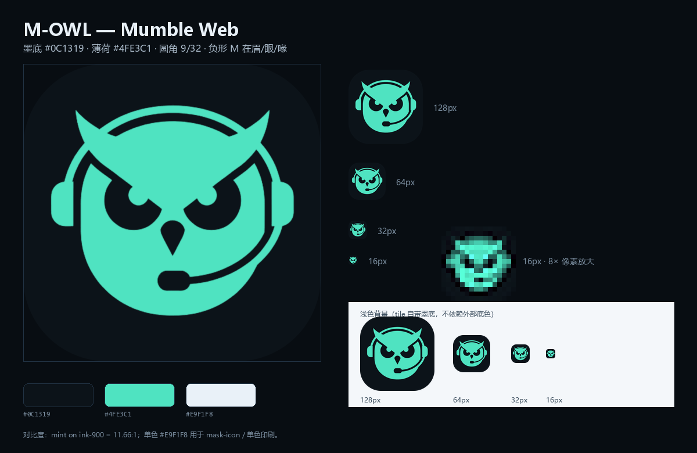

# Mumble Web 品牌规范（M-OWL）

> 状态：v1.1，2026-10-20。设计语言沿用「声场 / Soundfield」：深墨底、薄荷信号、
> 琥珀只给“正在发言”、系统字体、4/8 网格、圆角方 tile。
>
> 定稿基准：`brand-work/refs/logo-bottom-left-swapped-token.png`（左下角那版换色稿）。
>
> **生产采用位图优先**：从定稿位图清理出 512 主图，再导出 PNG/ICO；不再用 SVG 描摹作为生产源。
> `public/brand/mark.svg`、`public/favicon.svg`、`public/brand/mark-mono.svg` 是 S 版描摹清理稿，
> **标注为瑕疵版**：仅归档；其中 `mark-mono.svg` 只用于 Safari pinned tab 的 `mask-icon`。

## 1. 一句话

一只**警觉的猫头鹰**：墨底 `#0C1319`，薄荷正形 `#4FE3C1`；黑色眉/眼窝/喙在负空间里读出 **M**；
戴耳麦（头梁 + 双耳罩 + 右侧 boom + 嘴部 capsule），不是桌面麦克风。

## 2. 标志构成

| 部件 | 说明 |
|---|---|
| tile | 32×32 圆角方，`rx=9`（9/32），墨底 `#0C1319` |
| 猫头鹰 | 薄荷 `#4FE3C1`；耳尖短、角、向外；下巴柔 U，不尖 |
| 负形 M | 黑色眉带 = M 上边；两个黑色眼窝 = counters；薄荷桥 = 中竖；黑色喙 = 中间底部 |
| 耳麦 | 头梁细弧 + 左右耳罩 + 右侧 boom + 嘴部 capsule；**没有**支架/底座/第二个 boom |
| 单色 | `#E9F1F8`，仅用于 Safari pinned tab 的 `mask-icon`（S 版瑕疵 SVG）；生产不导出单色位图 |

## 3. 资产

| 文件 | 规格 | 用途 |
|---|---|---|
| `public/brand/mark-512.png` | 512，圆角 tile，外角透明 | **生产主图**；README/OG/PWA/派生源 |
| `public/brand/mark-owl-64/128/256.png` | owl-only alpha，透明底 | `BrandMark`（`srcSet`） |
| `public/favicon-16.png` / `favicon-32.png` | 16 / 32，PNG | 浏览器标签 |
| `public/favicon.ico` | 16 / 32 / 48 多尺寸 | 传统回退 |
| `public/apple-touch-icon.png` | 180×180，**不透明**，全出血墨底 | iOS 主屏（iOS 自己加圆角） |
| `public/icon-192.png` / `icon-512.png` | PWA `any`，圆角 tile，外角透明 | Android/桌面安装 |
| `public/icon-maskable-512.png` | 512，**全出血、无透明**，owl 在 80% 安全区 | Android 自适应图标 |
| `public/og-cover.png` | 1200×630 | 社交分享预览 |
| `public/brand/mark.svg` | S 版描摹清理，**瑕疵版** | 归档，不用于生产 |
| `public/favicon.svg` | S 版描摹清理，**瑕疵版** | 归档，不用于 favicon |
| `public/brand/mark-mono.svg` | S 版单色，**瑕疵版** | **仅** Safari pinned tab `mask-icon` |

**不要混用**：`any` 图标是“圆角 tile + 透明外角”；`apple-touch` 和 `maskable` 是
“全出血墨底 + 不透明”。把 `icon-512.png` 同时当 `maskable` 会被 Android 裁切。

## 4. 颜色

| Token | 值 | 用途 | 对比度 |
|---|---|---|---|
| ink-900 | `#0C1319` | tile、顶栏 | — |
| mint | `#4FE3C1` | 标志正形、当前/在线/主操作 | 对 ink-900 **11.66:1** |
| mono | `#E9F1F8` | 单色标志 | 对 ink-900 约 15.5:1 |
| line-control | `#557086` | tile 0.5 内描边（可选） | 约 3.6:1 |

不要用生成图的 `#09141A` / `#60E1BB`；不要给标志加渐变、内阴影、发光、琥珀/红/紫。

## 5. 留白与最小尺寸

- **最小尺寸**：favicon 16px；UI 内 20px（建议 24px）；独立使用 24px。
- **16px** 用 `public/favicon-16.png`（从 512 主图 Lanczos 缩放 + 轻微锐化）；
  不再单独画 16px 矢量，也不再用 `favicon.svg`。
- **留白**：独立摆放时，标志四周至少留 `1/4` 边长；不要把文字或图标贴到 tile 边缘。
- **UI tile**：32px tile 内 PNG 24px；44px tile 内 PNG 32px；不要拉伸。

## 6. 界面里的用法

- **TopBar**：32px tile + `Mumble`（semibold，紧凑字距）+ `WEB`（10–11px，`0.16em` 字距，`fg-subtle`）。
- **连接页**：44px tile + `Mumble Web` 标题 + 一句副标题；背景只保留声呐环，不加模糊色块。
- **BrandMark**：`mark-owl-256.png` + `srcSet`；CSS 提供 32/44px tile 与边框，PNG 只画 owl。
- **README**：首图用 `public/icon-192.png`（96×96 显示）；不要直接放大 16px 稿。
- **OG**：墨底 + 标志 + `Mumble` / `WEB` 字标 + 一条薄荷细线；不要堆功能点。

## 7. 字标

- `Mumble`：系统 UI 字体（Segoe UI / PingFang SC），600，负字距。
- `WEB`：全大写，600，`0.16em` 字距，`#7C8FA1`。
- 不引入 Web Font；不自己画字母；不把 `WEB` 放进 tile。

## 8. 禁止

- 不做 mint 底版本（只做墨底）。
- 不新增独立字母 M；M 只从眉/眼/喙的负形里读。
- 不用桌面麦克风/支架/底座；不加第二个 boom。
- 不拉伸、不旋转、不加描边、不加投影、不做动画。
- 不用 Mumble 官方标志；`Mumble` 只作兼容性描述，并保留非官方声明。
- 不把标志放进 16px 以下的尺寸；16px 用 `favicon-16.png`。
- **不要把 `mark.svg` / `favicon.svg` / `mark-mono.svg` 用于生产**：
  它们是 S 版描摹清理稿，已标注瑕疵版；`mark-mono.svg` 只在 Safari pinned tab 例外。
- 不要把 `favicon.svg` 重新加回 `<link rel="icon">`；生产 favicon 只用 PNG/ICO。

## 9. 重新生成

- **生产源**：`brand-work/refs/logo-bottom-left-swapped-token.png`（定稿位图）。
- 生成脚本：`brand-work/build/build_raster_assets.py`（本地维护）：
  清理颜色 → 512 主图 → 多尺寸 PNG/ICO → apple/maskable/OG。
- 输出：`public/brand/mark-512.png`、`mark-owl-{64,128,256}.png`、
  `favicon-{16,32}.png`、`favicon.ico`、`apple-touch-icon.png`、
  `icon-192/512.png`、`icon-maskable-512.png`、`og-cover.png`。
- **S 版 SVG 仅归档**：`public/brand/mark.svg`、`public/favicon.svg`、
  `public/brand/mark-mono.svg`；不要用它们生成生产 PNG。
- 修改标志时同步：`mark-512.png`、`mark-owl-*.png`、PNG/ICO、`BrandMark.tsx`、
  `index.html`、`site.webmanifest`、本文件。
- 渲染后按 512 / 180 / 32 / 16 检查；16px 必须单独看，不要只看 512。

## 10. 许可与商标

- 标志版权：Copyright (c) 2026 9.Solaris，随项目以 MIT License 发布。
- “Mumble” 是 Mumble 项目的商标；本项目是独立客户端，与 Mumble 项目无隶属或背书关系。
- 第三方组件许可见 [THIRD_PARTY_NOTICES.md](../../THIRD_PARTY_NOTICES.md)。
